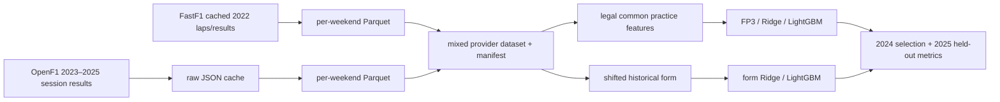
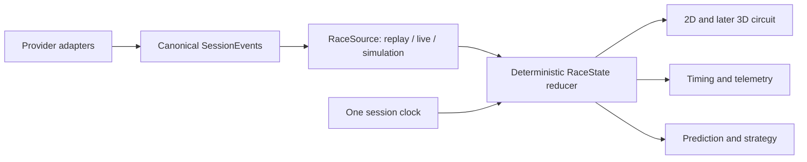

# F1LAB architecture: actual and target

## Implemented qualifying path

Each event is a prediction group. Training is 2022–2023, validation 2024,
test 2025. The row schema and timestamp policy are in `DATA_CONTRACTS.md`.
The existing React/Vite app is still the starter screen; it is not integrated
with predictions or replay yet. Python API and session-engine directories are
scaffolds.

## Canonical session foundation (P0, partial)

`src/f1_racelab/session/contracts.py` now defines versioned Pydantic
`SessionId`, `SessionEvent`, `DriverState` and `RaceState` objects. Events carry
source, UTC timestamps, session-relative seconds, sequence, lap, quality and a
typed payload. `reducer.py` applies events in strict order and reconstructs
state at a requested session time with `seek_state`. Duplicate event IDs are
idempotent; backward time, repeated sequence with a new ID and foreign
sessions are rejected. A late live packet must be ordered before reduction.

`openf1_sample.py` remains a 53-message contract smoke sample. The new
`openf1_replay.py` builds a local replay pack from the same race with measured
position changes, laps, pit stops, stints and indexed approximate locations.
`ReplaySource.state_at(t)` reads sparse events through reducer checkpoints,
then samples location and intervals at the same `t` into one `RaceState`.
`validate_replay.py` compares indexed seek to full reduction at 131 times.
The pack has one provider session, not a live source or a multi-session player.
`api.create_app` serves a manifest and `RaceState(t)` from the pack;
`apps/web` drives this API from one browser clock for the first 2D screen.

## Locked temporal architecture to extend

`RaceState` must be the single source of visible session truth. A future
animation frame may update drawing, but it cannot create a separate race clock.
Measured, interpolated and simulated values must remain distinguishable. The
local Monza UI is now wired to the replay pack through the Python API. It
requests one canonical state at most five times per second. The full
live/simulation and multi-session contract is still pending.

## Storage and module ownership

- `src/f1_racelab/data`: provider adapters and local Parquet/JSON lineage.
- `src/f1_racelab/features`: practice and strictly past qualifying features.
- `src/f1_racelab/models`: event grouped evaluation and model ablations.
- `src/f1_racelab/session`: typed event/state contracts, reducer, offline
  `RaceSource`, OpenF1 pack builder and replay QA.
- `src/f1_racelab/api.py`: local read-only replay HTTP API.
- `apps/web`: React/Vite one-race Race Control interface.
- `apps/api`, `services/session-engine`, `packages/*`: future service split
  and shared contracts; current contents are mostly empty scaffolding.
- `data/raw`, `data/cache`, `data/processed`: ignored local data artifacts.
- PostgreSQL/MinIO in Compose are intended stores, but no replay state or ML
  serving contract currently depends on them.
