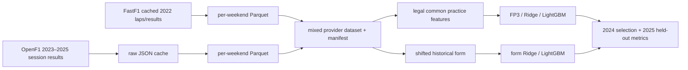
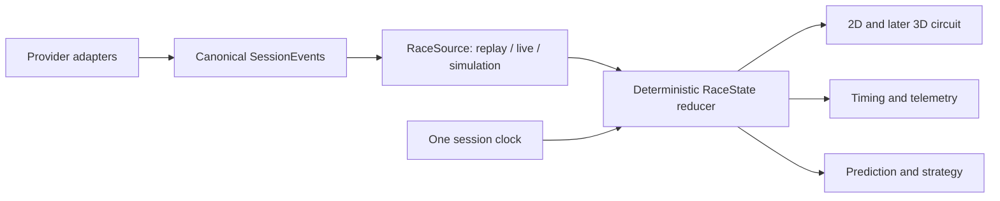

# F1LAB architecture: actual and target

## Implemented qualifying path

Each event is a prediction group. Training is 2022–2023, validation 2024,
test 2025. The row schema and timestamp policy are in `DATA_CONTRACTS.md`.
The existing React/Vite app is still the starter screen; it is not integrated
with predictions or replay yet. Python API and session-engine directories are
scaffolds.

## Locked temporal architecture to implement

`RaceState` must be the single source of visible session truth. A future
animation frame may update drawing, but it cannot create a separate race clock.
Measured, interpolated and simulated values must remain distinguishable. No
`SessionEvent`/`RaceState` implementation is claimed here yet.

## Storage and module ownership

- `src/f1_racelab/data`: provider adapters and local Parquet/JSON lineage.
- `src/f1_racelab/features`: practice and strictly past qualifying features.
- `src/f1_racelab/models`: event grouped evaluation and model ablations.
- `apps/web`: React/Vite interface, currently starter UI.
- `apps/api`, `services/session-engine`, `packages/*`: future typed API, reducer
  and shared contracts; current contents are mostly empty scaffolding.
- `data/raw`, `data/cache`, `data/processed`: ignored local data artifacts.
- PostgreSQL/MinIO in Compose are intended stores, but no replay state or ML
  serving contract currently depends on them.
