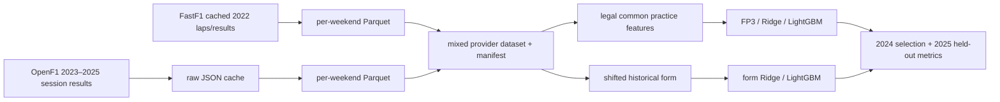
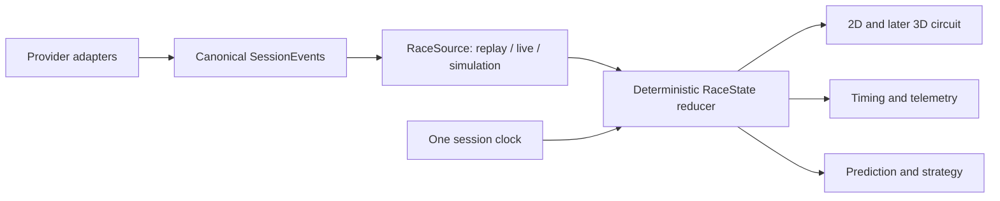

# F1LAB architecture: actual and target

## Implemented qualifying path

Each event is a prediction group. Training is 2022–2023, validation 2024,
test 2025. The row schema and timestamp policy are in `DATA_CONTRACTS.md`.
The React/Vite app integrates the local replay API and canonical session clock,
plus a separate historical Prediction Lab view. The Python API reads generated
qualifying prediction artifacts locally, verifies their manifest checksum and
returns per-event rank projections without querying a provider. Predictions
are historical and retrospective; strategy, live data and 3D are not served.

## Canonical session foundation (P0, partial)

`src/f1_racelab/session/contracts.py` now defines versioned Pydantic
`SessionId`, `SessionEvent`, `DriverState` and `RaceState` objects. Events carry
source, UTC timestamps, session-relative seconds, sequence, lap, quality and a
typed payload. `reducer.py` applies events in strict order and reconstructs
state at a requested session time with `seek_state`. Duplicate event IDs are
idempotent; backward time, repeated sequence with a new ID and foreign
sessions are rejected. A late live packet must be ordered before reduction.

`openf1_sample.py` remains a 53-message contract smoke sample. The new
`openf1_replay.py` builds a local replay pack from the same race with measured
position changes, laps, pit stops, stints and indexed approximate locations.
`ReplaySource.state_at(t)` reads sparse events through reducer checkpoints,
then samples location and intervals at the same `t` into one `RaceState`.
`validate_replay.py` compares indexed seek to full reduction at 131 times.
The builder now accepts audited catalog specs for Monza 2025, Monaco 2023
and Brazil 2024. `api.create_app` serves a session catalog and slug-specific
manifest/`RaceState(t)`; `apps/web` selects a session and drives the API
from one monotonic browser playback clock. Each state carries its source
capabilities; unavailable Monaco pit records cannot be read as a measured zero.

## Locked temporal architecture to extend

`RaceState` must be the single source of visible session truth. A future
animation frame may update drawing, but it cannot create a separate race clock.
Measured, interpolated and simulated values must remain distinguishable. The
local UI is wired to three replay packs through the Python API. It requests
one canonical state every 200 ms during playback and immediately on seeks.
Switching session remounts the workspace, cancels old requests and resets
the clock. The full live/simulation contract remains pending.

The first historical telemetry chart is a sidecar built from cached OpenF1
car data. Its immutable comparison points are aligned by estimated integrated
distance, while its vertical cursor is derived from the current canonical
`RaceState.session_time_seconds` and the reference lap's UTC start. Seeking to
that lap uses the existing browser clock. This produces a synchronized
historical comparison without treating estimated metres as another session
clock or as surveyed geometry. Details and boundaries are in
`DISTANCE_ALIGNED_TELEMETRY.md`.

## Storage and module ownership

- `src/f1_racelab/data`: provider adapters and local Parquet/JSON lineage.
- `src/f1_racelab/features`: practice and strictly past qualifying features.
- `src/f1_racelab/models`: event grouped evaluation and model ablations.
- `src/f1_racelab/session`: typed event/state contracts, reducer, offline
  `RaceSource`, OpenF1 pack builder and replay QA.
- `src/f1_racelab/api.py`: local read-only replay HTTP API.
- `apps/web`: React/Vite three-reference Race Control interface and real-pack
  Playwright tests; `lib/playback-clock.ts` owns browser playback time.
- `apps/api`, `services/session-engine`, `packages/*`: future service split
  and shared contracts; current contents are mostly empty scaffolding.
- `data/raw`, `data/cache`, `data/processed`: ignored local data artifacts.
- PostgreSQL/MinIO in Compose are intended stores, but no replay state or ML
  serving contract currently depends on them.
