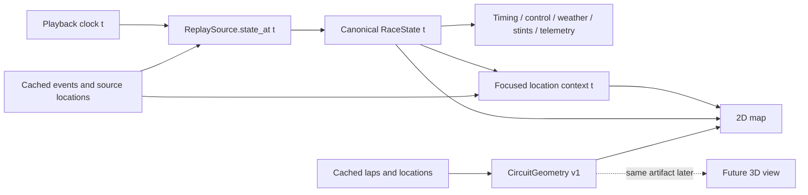

# Visual pipeline contract (partial implementation)

The local workstation renders Monza 2025, Monaco 2023 and Brazil 2024 from one
canonical `RaceState(t)`. The browser playback clock selects the requested
time; the API reconstructs timing, race control, weather, stints and current
locations at that time. Panels display the same returned state. The telemetry
cursor uses that state's session time rather than advancing its own clock.

## Geometry and source quality

`session.geometry` selects a measured driving line from eligible completed
laps, validates temporal coverage, closure and coordinate jumps, and creates
a deterministic geometry identity. The artifact retains source coordinates,
source hashes, source driver/lap, normalized aspect-preserving coordinates,
polyline arc lengths and tangent angles. An appended closing segment is
explicitly inferred; its size and rejection/selection diagnostics are retained.

Provider XY units are unknown. The line is approximate display geometry,
not surveyed track edges or centerline. Physical lap length/width and pit-lane
geometry are absent; no conversion from provider units to metres is made.
The UI origin marker denotes the first retained point of the source lap, not
an official timing line. Cars retain their source XY; no uniform-speed motion
or forced snapping around the circuit is introduced.

## Focused trail and direction

The local state route optionally accepts `focus_driver`. Its response adds
`location_context` at the same canonical time. It contains up to the previous
12 seconds of source samples, splitting at missing/implausible source spans.
The canonical current point is reused and labeled estimated when interpolated.
Historical trail samples are never taken from after the requested time.

The browser reconstructs the trail on every seek instead of accumulating
frame history. Exact revisits therefore produce the same trail, and changing
drivers does not change the clock. The arrow estimates recent displacement
direction; it is not chassis yaw. Missing/stationary/disconnected current
positions have no arrow. Existing location-staleness and interpolation quality
rules remain in force.

`TrackMap` memoizes its geometry projection/path and static SVG subtree. Cars
use a 180 ms transform transition only during normal forward playback;
paused seeks, reverse seeks and reduced-motion settings are immediate.
API state sampling remains 5 Hz, so this is not a claim of source observations
at display-frame frequency.

## Evidence and remaining work

The new browser scenario verifies geometry identity/origin, same-clock focused
trail/direction, exact forward/back trail reproduction and driver selection
without a clock change. Desktop/mobile renders are inspected. The opt-in
`npm run benchmark:replay` records visible RAF callback cadence, local request
and seek latency, long tasks, JS heap and atomic panel-clock agreement for the
three real packs; it does not measure painted GPU FPS or establish production
capacity. Exact reports and caveats are in
`REPLAY_GEOMETRY_AND_PERFORMANCE.md` and `TEST_EVIDENCE.md`.

Surveyed geometry, pit paths, official corner/sector metadata, broader source
coverage and sustained production rendering budgets remain open. A future
3D viewer must consume this shared geometry contract and canonical state;
P2 correctness precedes P8 rendering.
